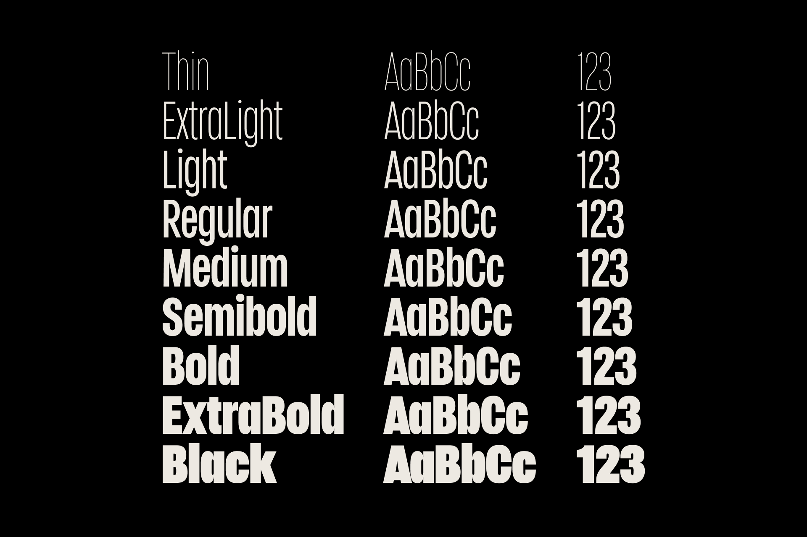

# Organize


Organize is a condensed sans-serif for people with something to say. Nine weights, from whisper-thin to shouting Black, come in one variable font. The tall x-height keeps it clear on headlines, posters and banners, and the optional circular O, C, G and Q give its tight, modular letters a touch of Art Deco.

The family covers Latin Core and Vietnamese, with a single weight axis (100–900) and nine static instances. OpenType features include six stylistic sets (circular O C G Q, double-storey a, straight t, spurless u, straight y, Et ampersand), standard ligatures (fi, fl, ff, ffi, ffl, ft, tt), fractions, tabular figures, superiors and inferiors, ordinals and case-sensitive forms.



## Building the Fonts

The source is `sources/Organize.glyphs` (Glyphs 3), built with [gftools builder](https://github.com/googlefonts/gftools).

Build and test with `make` (Python 3.10–3.12; the first run sets up a virtual environment from `requirements.txt`):

```
make build   # builds everything into fonts/
make test    # runs fontbakery (Google Fonts profile), reports in out/fontbakery/
make proof   # HTML proofs in out/proof/
make clean   # removes the virtual environment and build intermediates
```

Output goes to `fonts/`:

- `fonts/variable`: `Organize[wght].ttf`
- `fonts/ttf`: static TTFs (autohinted)
- `fonts/otf`: static OTFs
- `fonts/webfonts`: WOFF2

Every push to `main` and every pull request is built and tested on GitHub Actions. The fonts and Font Bakery reports are attached to each run as the `fonts-and-reports` artifact.

## License

Organize is licensed under the SIL Open Font License v1.1, see [OFL.txt](OFL.txt) for details.
